# CS457 Sprint 2 — Server Concurrency & Game Behavior Architecture

## 1. Scope

This document specifies the concurrency model, thread-safety strategy, turn synchronization scheme, and score broadcast design for the two-player Five-Card Draw Poker server. It builds on `protocol_blueprint.md` (message catalog, LF-framed JSON) and `fsm_specification.md` (game states). `server.py`, `game.py`, `protocol.py`, and `client.py` implement this design. Section 10 maps each requirement to the code.

## 2. Concurrency Model Selection

**Chosen model: Option A — Multi-Threading (`threading.Thread`, one worker thread per client socket).**

### 2.1 Rationale

| Factor | Multi-threading (chosen) | `selectors` event loop (rejected) |
|---|---|---|
| Client count | Fixed at 2 players. Two worker threads use very little memory. | Built for hundreds or thousands of sockets. That scale isn't needed here. |
| Receive code | Blocking `recv()` in a simple `while True` loop for each client | Non-blocking reads plus a per-socket read buffer and a per-socket write queue, with `EVENT_WRITE` handling for partial sends |
| Shared state | Needs an explicit `threading.Lock` | Runs in a single thread, so it needs no locks |
| Fit with existing code | `server.py`, `protocol.receive_messages()`, and `PokerGame` already use this model | Would need the I/O layer rewritten |
| Main risk | Race conditions on shared state, which the locking strategy in Section 5 controls | A single slow handler stalls every client |

Poker is turn-based and has exactly two players, so contention is low. The cost of threading is the need for disciplined locking, and Section 5 makes that explicit and auditable.

### 2.2 Why the main loop never blocks on a client

Each client gets its own worker thread, which spends nearly all of its time blocked in `sock.recv()`. A blocked `recv()` only suspends that worker; it does not suspend the main thread or the other worker. The main thread only blocks in `accept()`, which has a 1 s timeout so the loop can check `game_over_event` and expired reconnect deadlines regularly. It never reads from a client socket.

### 2.3 Thread inventory

| Thread | Count | Created by | Responsibilities | Blocking calls |
|---|---|---|---|---|
| Main thread | 1 | Python interpreter | `bind`/`listen`, accept loop (runs for the whole match), configuring and handing each new socket to a worker, forfeiting players whose reconnect deadline passed, final shutdown | `accept()` (1 s timeout), `thread.join()` at shutdown |
| Client worker | 1 per accepted connection (2 players, plus short-lived ones for rejected or returning clients) | Main thread | Read `CONNECT` and join, rejoin, or reject; starting the game when the second player joins; receive, frame, and parse messages for one socket; validate and apply actions; broadcast results; run disconnect cleanup | `recv()` and `game_lock.acquire()` |

Workers are created with `daemon=True`, so a worker stuck in `recv()` cannot keep the process alive after shutdown.

## 3. Connection Lifecycle

```text
 LISTEN ──► ACCEPT ──► JOIN (on CONNECT) ──► LOBBY ──► SERVICE (game loop) ──► TEARDOWN
                          │                                │       ▲
                          │                          drop  ▼       │ same name + IP
                          │                         PAUSED (seat held 120 s) ──► FORFEIT
                          └── 3rd client / wrong identity: ERROR, close
```

### 3.1 Listen

1. Create `socket.socket(AF_INET, SOCK_STREAM)`.
2. Set `SO_REUSEADDR` so the server can restart right away while the old port is in `TIME_WAIT`.
3. Run `bind(("0.0.0.0", 5050))`, then `listen(2)`. The backlog of 2 holds both players while the main thread is handing the first one to its worker.

### 3.2 Accept (main thread) and join (worker thread)

For each `sock, address = server_socket.accept()`, the main thread:

1. Sets `sock.settimeout(SOCKET_TIMEOUT)` and enables `SO_KEEPALIVE` (see Section 5.4).
2. Starts `threading.Thread(target=handle_client, args=(sock, address), daemon=True)`. It does **not** assign a role: the role depends on the name in `CONNECT`, which only the worker reads.

The worker's first message must be `CONNECT {name}`. Anything else gets `ERROR NOT_JOINED`, and a connection that sends nothing for 30 s is closed. On `CONNECT`, the worker **acquires `game_lock`** and calls `_join_locked(sock, address, name)`. The player's identity is `(name, address[0])`, meaning the name plus the IP the connection came from.

- **Lobby (`WAITING_FOR_PLAYERS`):** if two players are seated, send `ERROR GAME_FULL` and close. If another seated player already uses the name, send `ERROR NAME_TAKEN` and close, so a returning player always matches exactly one seat. Otherwise assign the first free role (`Player_1`, then `Player_2`), insert `players[role] = sock` and `identities[role] = (name, ip)`, and send `LOBBY_WAIT {players_connected, players_required: 2}`.
- **Match paused for a dropped player:** if the identity equals `identities[role]` for a role in `reconnect_deadlines`, the connection retakes that role (Section 3.6). Any other connection gets `ERROR RECONNECT_REJECTED` and is closed.
- **Match full or over:** `ERROR GAME_FULL` and close.

The **socket identifies the player**. The role is bound to the socket here and never taken from a client-supplied `player_id`. The worker then **releases `game_lock`**.

### 3.3 Game start

After a join, the worker calls `try_start_game()`. That function acquires `game_lock`, confirms two players are connected and the game is still in the lobby, and calls `start_game()`. That function does the following:

- shuffles and deals
- picks `first_player`
- sends `GAME_START` to each client, with a role-specific `your_role` field
- sends each client its own `HAND` privately
- broadcasts the first `STATE_UPDATE`

The worker that seated the second player holds the lock for this whole sequence. That way, neither worker can process an `ACTION` until both clients have their cards and the initial state.

### 3.4 Active game loop (worker threads)

```python
def handle_client(sock, address):
    player_id = None                                              # no seat until CONNECT
    buffer = b""
    try:
        while True:
            messages, buffer, connected = receive_messages(sock, buffer)  # NO lock held
            if not connected:                                     # recv() == b""
                break
            for message in messages:
                if player_id is None:
                    player_id, rejected = process_join(sock, address, message)  # takes game_lock
                    if rejected:
                        return
                    continue
                process_message(player_id, sock, message)         # takes game_lock
            if player_id is not None and players.get(player_id) is not sock:
                break                                             # DISCONNECT or failed send
    except OSError:
        pass
    finally:
        if player_id is not None:
            handle_disconnect(player_id, sock)                    # takes game_lock
```

- `buffer` and `player_id` are **local variables of the worker**, so framing state is never shared between threads.
- The worker receives, frames, and checks schema (`validate_message`, `validate_action`) **without holding the lock**. These are pure functions of the bytes on one socket.
- `process_join` and `process_message` acquire `game_lock` before they read or change game state, and before they send anything (Section 5).

### 3.5 Teardown

Any of the following events triggers teardown for one player:

| Trigger | Detected by | Path | Result mid-match |
|---|---|---|---|
| `DISCONNECT {reason: QUIT}` | Worker parses the message | `handle_disconnect(player_id, sock, forfeit=True)` | Forfeit |
| Orderly close (FIN) | `recv()` returns `b""` | Loop `break` leads to the `finally` block | Paused, seat held |
| Reset or abort | `ConnectionResetError` / `ConnectionAbortedError` | `except` leads to the `finally` block | Paused, seat held |
| Silent network drop | `SO_KEEPALIVE` probes fail, and `recv()` raises `TimeoutError` with an errno (kernel `ETIMEDOUT`) | `except` leads to the `finally` block | Paused, seat held |
| Send to dead peer | `BrokenPipeError` during `broadcast` | Broadcast calls `_disconnect_locked(player_id, sock)` | Paused, seat held |

`handle_disconnect` acquires `game_lock` and then calls `_disconnect_locked(player_id, sock, forfeit)`, which does the following:

1. If `players.get(player_id) is not sock`, it returns immediately. This **idempotency guard** stops EOF and a failed send from both handling the same departure. Because it compares the socket, it also stops a stale worker from removing a player who has already reconnected on a new socket.
2. `players.pop(player_id)` and `sock.close()` (ignoring `OSError`).
3. In the lobby, it frees the role and the name so a new client can take them.
4. Mid-match with `forfeit=True`, it calls `end_game(opponent, "FORFEIT")`. That function broadcasts `GAME_OVER` and sets `game_over_event`.
5. Mid-match without `forfeit`, it **keeps all game state**, records `reconnect_deadlines[player_id] = now + 120 s`, and sends `PLAYER_DISCONNECTED` to the opponent. While a seat is empty, `handle_action` answers every `ACTION` with `ERROR GAME_PAUSED`.

### Reconnect

When a joining connection matches a paused seat (Section 3.2), `_resume_locked` runs in the same critical section:

1. Remove the deadline and set `players[player_id] = sock`.
2. Send the returning client `GAME_START {resumed: true}`, its private `HAND`, and the current `STATE_UPDATE` (same `seq`, so the opponent sees no gap).
3. Send `PLAYER_RECONNECTED` to the opponent. Play continues from the same phase, turn, pot, and chips.

Each time around the accept loop, the main thread calls `expire_reconnects()`. Under `game_lock`, it forfeits any player whose deadline has passed: `end_game(opponent, "FORFEIT")`, or `end_game(None, "ABANDONED")` if both players are gone.

### 3.7 Server shutdown

`end_game()` sets `game_over_event`. The accept loop sees the event within 1 s and calls `shutdown()`, which does the following:

1. Join each worker thread for up to 5 s. Clients close their end after `GAME_OVER`, so workers normally exit on EOF. Waiting first means no unread data is left to trigger a TCP reset that could discard `GAME_OVER`.
2. Acquire `game_lock`, close every remaining socket in `players`, clear the dict, and release the lock.
3. Close `server_socket`.

Any worker still blocked in `recv()` gets an `OSError` or EOF and exits. Its `finally` cleanup does nothing because its player has already been removed.

## 4. Shared Resources

Both workers and the main thread can reach everything below, so all of it is protected by `game_lock`.

| Resource | Type | Written by | Read by | Corruption if unprotected |
|---|---|---|---|---|
| `players` | `dict[str, socket]` | Workers (join, reconnect, disconnect), main (shutdown) | Every send path, `broadcast`, pause check | `RuntimeError: dictionary changed size during iteration` in the middle of a broadcast. A message sent to a closed socket. Two clients both assigned `Player_1`. |
| `identities` | `dict[str, (name, ip)]` | Workers (join, lobby disconnect) | Join and reconnect matching | Two players with the same name, so a returning player matches the wrong seat. |
| `reconnect_deadlines` | `dict[str, float]` | Workers (drop, reconnect), main (`expire_reconnects`) | Join, `expire_reconnects` | A player reconnects in the same instant their deadline expires, so they are both reseated and forfeited. |
| `game.state`, `game.phase` | `str` | `start_game`, `handle_action`, `end_round`, `end_game` | Every action validation | An action accepted after `GAME_OVER`. A phase skipped. |
| `game.active_player` | `str` | `switch_turn`, `start_game` | Turn check in `handle_action` | **Check-then-act race:** both players pass the turn check before either switches the turn. |
| `game.deck` | `list[str]` | `start_round`, `draw_cards` | — | Two `pop()` calls during interleaved draws give a duplicate or lost card, or an `IndexError`. |
| `game.player_1_hand`, `game.player_2_hand` | `list[str]` | `start_round`, `draw_cards` | `send_hand`, `showdown` | Showdown evaluates a hand halfway through a replacement. |
| `game.round_number` | `int` | `next_round` | `ROUND_OVER`, `STATE_UPDATE`, `check_game_over` | Round skipped or counted twice. |
| `game.player_N_wins`, `game.player_N_streak` | `int` | `record_round_win` | `check_game_over`, every broadcast | A lost update (`+=` is not atomic). A streak check that reads an old value. |
| Socket send stream | Kernel buffer per socket | Any thread that calls `send_message` | Peer | Bytes from two `sendall` calls **interleave**, producing a corrupt JSON line. |

**State that is not shared and needs no lock:** each worker's `buffer` and loop variables, and the parsed `message` dicts. A worker also calls `recv()` only on its own socket.

## 5. Thread Safety & Lock Acquisition Strategy

### 5.1 One coarse lock

The server uses a **single `threading.Lock` named `game_lock`** that covers every resource in Section 4. Here is why it is coarse-grained:

- With one lock, threads cannot acquire locks in conflicting orders, so **lock-ordering deadlock cannot happen**.
- Most poker actions touch several resources at once (turn, deck, hand, scores, players). Separate locks would need to be held together anyway.
- With only 2 clients and human think time between moves, contention is negligible.

### 5.2 Lock rules

1. **Never hold `game_lock` during `recv()` or `accept()`.** A thread holding the lock while it waits for network input would freeze every other thread.
2. **Validate, mutate, and broadcast inside one critical section.** The turn check, the state change, and the resulting broadcasts happen under one lock acquisition. Releasing the lock between the check and the change would bring back the check-then-act race.
3. **Every send happens under `game_lock`**, including single-client `ERROR` and `HAND` messages. `sendall()` from two threads on the same socket is not atomic, so this rule is what prevents interleaved frames.
4. **No re-acquisition.** `threading.Lock` is not reentrant. Functions that expect the caller to already hold the lock end in `_locked` (for example `_join_locked`, `_resume_locked`, `_disconnect_locked`) or are documented as such (`broadcast`, `end_round`, `end_game`). Only the entry points `process_join`, `try_start_game`, `process_message`, `handle_disconnect`, `expire_reconnects`, and the shutdown sequence call `with game_lock:`.
5. **Always use `with game_lock:`**, never bare `acquire()`/`release()`. The lock is then released even when an exception is raised inside the critical section.

### 5.3 Critical sections

| # | Entry point (thread) | Lock held across |
|---|---|---|
| CS-1 | `process_join` (worker) | capacity, name, and identity checks → role assignment or reconnect → `players[...] = sock` → `LOBBY_WAIT`, or for a reconnect `GAME_START`/`HAND`/`STATE_UPDATE`/`PLAYER_RECONNECTED` |
| CS-2 | `try_start_game` (worker that seated player 2) | deal → `GAME_START` ×2 → `HAND` ×2 → `STATE_UPDATE` broadcast |
| CS-3 | `process_message` → `ACTION` (worker) | state/phase/turn checks → mutation → `HAND`/`STATE_UPDATE`/`ROUND_OVER`/`GAME_OVER` sends |
| CS-4 | `process_message` → schema failure (worker) | sending `ERROR` only |
| CS-5 | `handle_disconnect` (worker) | idempotency guard → `players.pop` → `close` → forfeit `GAME_OVER`, or reconnect deadline + `PLAYER_DISCONNECTED` |
| CS-6 | Shutdown (main) | closing all sockets, clearing `players` |
| CS-7 | `expire_reconnects` (main, about once a second) | deadline check → forfeit `GAME_OVER` |

Acquire and release pattern for CS-3:

```python
def process_message(player_id, sock, message):
    valid, error = validate_message(message)        # outside lock: pure function
    if not valid:
        with game_lock:                             # CS-4: lock only to serialize the send
            send_error(sock, error, "Invalid protocol message.")
        return

    if message["msg_type"] == "ACTION":
        with game_lock:                             # CS-3: acquire
            handle_action(player_id, sock, message["payload"])
                                                    # validate → mutate → broadcast
                                                    # release (also on exception)
    elif message["msg_type"] == "DISCONNECT":
        handle_disconnect(player_id)                # CS-5: acquires internally
```

Broadcast failure handling while the lock is held (no recursion into the lock):

```python
def broadcast(message):                             # caller holds game_lock
    dead = []
    for player_id, sock in list(players.items()):   # snapshot: safe even if we pop below
        try:
            send_message(sock, message)
        except (BrokenPipeError, ConnectionResetError, ConnectionAbortedError, TimeoutError):
            dead.append(player_id)
    for player_id in dead:
        _disconnect_locked(player_id)               # does NOT re-acquire game_lock
```

### 5.4 Bounding time spent holding the lock

The lock is held while sending, so a peer that stops reading could block `sendall()` once its TCP window fills. To bound that:

- Each client socket gets `settimeout(SOCKET_TIMEOUT)` (30 s). A stalled `sendall()` then raises `TimeoutError`, and the peer is treated as disconnected.
- The same timeout also applies to `recv()`. A waiting player can legitimately stay silent for a long time while the opponent thinks, so a `recv()` timeout is **not** a disconnect. The worker checks `error.errno is None` (Python's socket timeout) and loops again. A kernel `ETIMEDOUT` has an errno and is treated as a dead peer.
- `SO_KEEPALIVE` lets the OS detect a peer that disappeared without sending FIN or RST.
- Messages are small (well under 1 KiB) compared with socket buffers (tens of KiB), so in normal play a send never blocks.

### 5.5 Race-condition analysis

| # | Race scenario | Without protection | With this design |
|---|---|---|---|
| R1 | Both players submit `ACTION` at the same instant | Both read `active_player == Player_1` before either switches. Two moves are applied for one turn. | CS-3 serializes them. The second worker sees the updated `active_player` and gets `ERROR OUT_OF_TURN`, or its move is valid if the turn has really passed to it. |
| R2 | Player 1 sends `DRAW` twice in quick succession | Two concurrent `deck.pop()` sequences | Both messages come from the same worker, so they are handled one after the other. The second sees `active_player == Player_2` and is rejected. |
| R3 | A disconnect while the other worker is broadcasting | `players` changes size while being iterated, or a send goes to a closed socket | CS-5 cannot start until CS-3 releases the lock. The broadcast also iterates over a `list()` snapshot. |
| R4 | EOF and a broadcast send failure both detect the same dead player | The departure is handled twice: two `PLAYER_DISCONNECTED` notices, or two forfeits and two `GAME_OVER` messages | The `if players.get(player_id) is not sock: return` guard runs under the lock, so only the first detection does anything. |
| R5 | `ERROR` to Player 1 from its own worker while Player 2's worker broadcasts `STATE_UPDATE` to Player 1 | Interleaved bytes produce a corrupt JSON line on Player 1's socket | Rule 3: every send runs under `game_lock`, so the frames on one socket stay whole. |
| R6 | A player's `ACTION` arrives before `start_game` finishes | The action runs against a half-dealt game | Its worker blocks on the lock until CS-2 is finished, then sees `state == PLAYER_TURN`. |
| R7 | Two clients send `CONNECT` at the same time | Two sockets assigned `Player_2` | Each join is handled under CS-1, so the capacity check and the insert into `players` are atomic. |
| R9 | A dropped player reconnects before their old worker has finished cleanup | The old worker's `finally` removes the **new** socket, and the player is dropped again | The guard compares sockets (`players.get(player_id) is not sock`), so the stale worker's cleanup does nothing. |
| R10 | A player reconnects in the same second their deadline expires | Reseated and forfeited at once | The join (CS-1) and `expire_reconnects` (CS-7) both run under `game_lock`. Whichever runs first removes the deadline, so the other sees a consistent result. |
| R11 | The opponent acts while the seat is empty | A move is applied that the missing player never sees, or a broadcast is skipped | `handle_action` checks `len(players) < 2` under the lock and answers `ERROR GAME_PAUSED` without changing state. |
| R8 | A disconnect lands between `ROUND_OVER` and the next deal | A hand is sent to a closed socket | `send_hand` skips players who aren't in `players`. The new hand stays in the saved game, and the player receives it on reconnect. Until then every `ACTION` gets `GAME_PAUSED`. |

## 6. Turn Enforcement & Move Validation

`handle_action` (inside CS-3) runs these checks **in order** and stops at the first failure. **No state is changed until every check passes**, so a rejected move cannot corrupt the game.

| Order | Check | Failure response |
|---|---|---|
| 0 | JSON parses and the envelope is valid (outside the lock) | `ERROR MALFORMED_JSON` / `INVALID_MESSAGE` |
| 1 | Payload schema: known `action`, `BET.amount` a positive int, `DRAW.cards` distinct ints 0–4 | `ERROR INVALID_ACTION` / `INVALID_BET` / `INVALID_CARD_INDEX` |
| 2 | `game.state == "PLAYER_TURN"` (not lobby, showdown, or game over) | `ERROR INVALID_STATE` |
| 2b | Both players connected (no seat waiting for a reconnect) | `ERROR GAME_PAUSED` |
| 3 | `player_id == game.active_player`, where `player_id` comes from the **socket**, not the envelope | `ERROR OUT_OF_TURN` |
| 4 | Action legal in the current `phase` (for example `DRAW` only in `DRAW_PHASE`, once per player; `CALL` only when a bet is outstanding; `BET` no larger than either player's chip stack) | `ERROR INVALID_ACTION` / `INVALID_BET` |
| 5 | Apply the mutation, then broadcast | — |

`ERROR` goes **only** to the offending client. The opponent's view doesn't change, because the shared state didn't change.

## 7. Broadcast & Synchronization Guarantees

"Synchronous broadcast" in this design means the following guarantees:

1. **One snapshot.** Each `STATE_UPDATE` payload is built once from `game.public_state()`, inside the same critical section as the mutation. Both clients get byte-for-byte identical public state.
2. **All or nothing before the next change.** The broadcast loop sends to every connected player **before** `game_lock` is released. No later move can be applied, and no other message sent, until both clients have the update in their TCP send buffers.
3. **Same order for both clients.** Every send happens under one lock and TCP keeps the byte order on each connection, so both clients see the message sequence (`STATE_UPDATE` → `ROUND_OVER` → `HAND` → `STATE_UPDATE` …) in the same relative order.
4. **Private data stays private.** `HAND` is sent with `send_message(players[pid], …)` to its owner only and is never passed to `broadcast`. `public_state()` contains no cards.
5. **Failure isolation.** If the send to one client fails, that client goes through the disconnect path: the game is paused and their seat is held for a reconnect. The other client still gets the broadcast, followed by `PLAYER_DISCONNECTED`.
6. **Ordering check.** Every `STATE_UPDATE` carries a `seq` counter that is incremented under the lock. The client prints a warning if it ever sees a gap.

## 8. Score & Leaderboard Synchronization

### 8.1 In-memory storage

`PokerGame` holds the scores. The single `game` instance is created once at server start and is protected by `game_lock`.

| Field | Meaning | Updated in |
|---|---|---|
| `round_number` | Current round (1–`max_rounds`) | `next_round()` |
| `player_1_wins`, `player_2_wins` | Total rounds won (the leaderboard) | `record_round_win()` |
| `player_1_streak`, `player_2_streak` | Current consecutive-win streak | `record_round_win()` |
| `chips` | Each player's chip stack (starts at 100). A stack of 0 ends the match with `OUT_OF_CHIPS` | `put_chips()`, `record_round_win()` (pot payout) |
| `max_rounds` | Round limit (10) | Constructor |

Scores are **server-authoritative**. Clients only display what the server sends and never compute or report a winner.

### 8.2 Update rules (`record_round_win`)

- Winner: `wins += 1`, `streak += 1`, opponent's `streak = 0`.
- Tie (`winner is None`): both streaks reset to 0, and wins are unchanged.
- Chips: the winner takes the pot. On a tie, each player gets back what they put in that round.
- `check_game_over()` then tests for an empty chip stack (`OUT_OF_CHIPS`), `streak >= 3` (match win), or `round_number >= max_rounds` (draw).

### 8.3 Broadcast sequence on round completion

All of these steps happen inside the **single critical section** of the `ACTION` (`CALL` or `FOLD`) that ended the round:

1. Determine the winner: `showdown()` compares the two hands, and `FOLD` makes the opponent the winner.
2. `record_round_win(winner)` updates wins and streaks.
3. `broadcast(ROUND_OVER)`, which carries the new score table:
   ```json
   {"msg_type":"ROUND_OVER","player_id":"SERVER","payload":{"round":3,"winner":"Player_1","reason":"SHOWDOWN","winning_hand":"Two Pair","player_1_wins":2,"player_2_wins":1,"player_1_streak":2,"player_2_streak":0},"timestamp":1727000010}
   ```
4. `check_game_over()`:
   - **Continue:** `next_round()` (which picks the next first player: the previous round's winner has a 40% chance, and a tie is 50/50), a private `HAND` to each player, then `broadcast(STATE_UPDATE {last_action: "NEW_ROUND", round, scores…})`.
   - **Match over:** `broadcast(GAME_OVER {winner, reason, rounds_played, player_1_wins, player_2_wins})` and set `game_over_event`.

The score change and both broadcasts happen under the same lock acquisition, so a client can never see the next round's `STATE_UPDATE` before the `ROUND_OVER` that justified it. The two clients' leaderboards also can't disagree. Every `STATE_UPDATE` repeats the current wins and streaks, so a client's scoreboard is correct even if it skipped processing a `ROUND_OVER`.

## 9. State & Score Broadcast Sequence Diagram

The diagram shows every protocol message the game uses: `CONNECT`, `LOBBY_WAIT`, `GAME_START`, `HAND`, `ACTION` (`CHECK`, `BET`, `CALL`, `ALL_IN`, `FOLD`, `DRAW`), `STATE_UPDATE`, `ERROR`, `ROUND_OVER`, `PLAYER_DISCONNECTED`, `PLAYER_RECONNECTED`, `GAME_OVER`, and `DISCONNECT`.

To keep it readable, the server is drawn as one participant. Internally, each message is handled by the worker thread of the client that sent it, and every server step shown runs inside one `game_lock` critical section (Sections 3 and 5). The round uses the real phase order: `BETTING_1` → `DRAW_PHASE` → `BETTING_2` → showdown, with `Player_1` acting first.

```mermaid
sequenceDiagram
    autonumber
    actor C1 as Client 1 (Player_1)
    participant S as Server
    actor C2 as Client 2 (Player_2)

    Note over C1,C2: Lobby - waiting to join, then joined
    C1->>S: CONNECT (name Alex)
    S-->>C1: LOBBY_WAIT (1 of 2 players)
    C2->>S: CONNECT (name Blake)
    S-->>C2: LOBBY_WAIT (2 of 2 players)
    Note over S: Shuffle, deal, pick first player, 100 chips each
    par Game start to both
        S-->>C1: GAME_START (your_role Player_1)
    and
        S-->>C2: GAME_START (your_role Player_2)
    end
    S-->>C1: HAND (Player_1 cards only)
    S-->>C2: HAND (Player_2 cards only)
    par State broadcast
        S-->>C1: STATE_UPDATE (BETTING_1, turn Player_1, chips 100-100)
    and
        S-->>C2: STATE_UPDATE (BETTING_1, turn Player_1, chips 100-100)
    end

    Note over C1,C2: Turn enforcement and move validation
    C2->>S: ACTION (CHECK)
    Note over S: Active player is Player_1
    S-->>C2: ERROR (OUT_OF_TURN) - state unchanged
    C1->>S: ACTION (BET, amount 20)
    Note over S: Check state, turn, phase, and bet within chips
    alt Valid move
        Note over S: Move 20 chips to the pot, turn to Player_2
        par Broadcast before the lock is released
            S-->>C1: STATE_UPDATE (turn Player_2, pot 20, to call 20)
        and
            S-->>C2: STATE_UPDATE (turn Player_2, pot 20, to call 20)
        end
    else Illegal move or bad payload
        S-->>C1: ERROR (INVALID_ACTION or INVALID_BET) - state unchanged
    end

    Note over C1,C2: Each move below gets the same checks and a STATE_UPDATE to both clients
    C2->>S: ACTION (CALL) - closes BETTING_1
    C1->>S: ACTION (DRAW, cards 1 and 3)
    S-->>C1: HAND (new Player_1 cards only)
    C2->>S: ACTION (DRAW, keep all)
    S-->>C2: HAND (Player_2 cards only)
    C1->>S: ACTION (ALL_IN, 80 chips) - in BETTING_2

    Note over C1,C2: Round over and score sync
    alt Player_2 calls
        C2->>S: ACTION (CALL)
        Note over S: Showdown - better hand takes the pot
    else Player_2 folds
        C2->>S: ACTION (FOLD)
        Note over S: Player_1 takes the pot
    end
    Note over S: Update chips, wins, and streaks
    par Score broadcast
        S-->>C1: ROUND_OVER (winner, hand, pot, chips, wins, streaks)
    and
        S-->>C2: ROUND_OVER (winner, hand, pot, chips, wins, streaks)
    end
    alt Match continues
        S-->>C1: HAND (new Player_1 cards)
        S-->>C2: HAND (new Player_2 cards)
        par State broadcast
            S-->>C1: STATE_UPDATE (round 2, chips, wins, streaks)
        and
            S-->>C2: STATE_UPDATE (round 2, chips, wins, streaks)
        end
    else Out of chips, 3 wins in a row, or round 10 played
        par Final result
            S-->>C1: GAME_OVER (winner, reason, final chips and wins)
        and
            S-->>C2: GAME_OVER (winner, reason, final chips and wins)
        end
    end

    Note over C1,C2: Mid-match drop and reconnect
    C2--xS: Connection drops without DISCONNECT
    Note over S: Keep all game state, hold the seat 120 s
    S-->>C1: PLAYER_DISCONNECTED (Player_2, 120 s)
    C1->>S: ACTION (CHECK)
    S-->>C1: ERROR (GAME_PAUSED) - state unchanged
    alt Same name and IP within 120 s
        C2->>S: CONNECT (name Blake)
        S-->>C2: GAME_START (resumed true)
        S-->>C2: HAND (same cards)
        S-->>C2: STATE_UPDATE (same turn, pot, and chips)
        S-->>C1: PLAYER_RECONNECTED (Player_2)
    else Deadline passes
        S-->>C1: GAME_OVER (winner Player_1, FORFEIT)
    end

    Note over C1,C2: Deliberate quit
    C1->>S: DISCONNECT (QUIT)
    S-->>C2: GAME_OVER (winner Player_2, FORFEIT)
    Note over S: Close all sockets and shut down
```



### 9.1 Narrative

**Lobby.** Each client connects and sends `CONNECT` with a name. The server seats it and replies `LOBBY_WAIT`. When the second player joins, the server deals and sends each client its own `GAME_START` and private `HAND`, then broadcasts one `STATE_UPDATE` to both. All of this happens under one lock acquisition, so no `ACTION` can run against a half-dealt game. A third client gets `ERROR GAME_FULL` and is disconnected.

**Turn enforcement and validation.** Client 2 tries to act on Player 1's turn and gets `ERROR OUT_OF_TURN`. Nothing changes, so nothing is broadcast. Client 1's `BET` then goes through the full check order (Section 6): game state, turn, phase, and a bet no larger than either stack.

- **Valid move:** the server moves the chips, switches the turn, and sends the same `STATE_UPDATE` snapshot to both clients before releasing the lock.
- **Illegal move:** the `alt`/`else` branch sends `ERROR` to the mover only, and the state stays unchanged.

The rest of the round uses the same validate, mutate, and broadcast pattern. A `CALL` closes `BETTING_1`. Each player draws once and gets the new cards in a private `HAND`. Player 1 goes all in during `BETTING_2`.

**Round over and score sync.** A `CALL` leads to a showdown, and a `FOLD` gives the pot to the opponent. In the same critical section, the server pays the pot, updates wins and streaks, and broadcasts `ROUND_OVER` with the full score table to both clients. If the match continues, it deals the next round and broadcasts a `STATE_UPDATE`. Otherwise it broadcasts `GAME_OVER` (out of chips, three wins in a row, or the round limit). Both clients get the same score table in the same order, and no move from the next round can arrive in between.

**Drop and reconnect.** If a connection closes without `DISCONNECT`, the server keeps the whole game, holds the seat for 120 s, and sends `PLAYER_DISCONNECTED` to the other client. Moves during the pause get `ERROR GAME_PAUSED`. A client that reconnects with the same name and IP gets `GAME_START {resumed: true}`, the same `HAND`, and the current `STATE_UPDATE`, and the opponent gets `PLAYER_RECONNECTED`. If the deadline passes first, the missing player forfeits.

**Quit.** `DISCONNECT {reason: QUIT}` is a deliberate exit, so the opponent wins by forfeit right away. The server then closes every socket and shuts down.

## 10. Implementation Mapping

| Design requirement | Where it is implemented |
|---|---|
| One worker thread per client, main loop never reads client sockets | `server.py` `main()`, `handle_client()` |
| Single `game_lock` and the `_locked` convention | `server.py` shared state section, `_disconnect_locked()` |
| Every send under `game_lock` (R5) | `process_message()` wraps the schema-error send. All other sends run inside locked entry points. |
| Join under the lock on `CONNECT`, third client gets `GAME_FULL` (CS-1, R7) | `process_join()` → `_join_locked()`. The accept loop runs for the whole match. |
| Saved game, reconnect by name and IP, 120 s forfeit (3.5, R9–R11) | `_disconnect_locked()`, `_resume_locked()`, `expire_reconnects()`, `RECONNECT_TIMEOUT` |
| Idempotent disconnect and forfeit (R3, R4, R9) | `handle_disconnect()` → `_disconnect_locked()` socket guard. `end_game()` also ignores a second call. |
| Validate before mutating (Section 6) | `handle_action()` → `validate_action()`, state, turn, then `PokerGame.action_error()`, and only then `apply_action()` |
| FSM phase rules: two checks or a call close betting, no raise, `DRAW` once and only in `DRAW_PHASE` | `game.py` `action_error()`, `apply_action()`, `close_betting()` |
| First-player rule (40% for the previous winner) | `game.py` `choose_first_player()` |
| Bounded send time and silent-drop detection (5.4) | `SOCKET_TIMEOUT`, `SO_KEEPALIVE`, errno check in `handle_client()` |
| `seq` ordering check (Section 7) | `broadcast_state()`, client `STATE_UPDATE` handler |
| `MALFORMED_JSON` and byte-level framing | `protocol.py` `receive_messages()` (byte buffer), `validate_message()` |
| Client re-prompts after `ERROR` and offers only legal actions | `client.py` `legal_choices()`, `ERROR` handler |

**Known naming difference:** score payloads use flat keys (`player_1_wins` and so on), while the Sprint 1 blueprint shows `wins: {...}` objects. Messages also include `pot`, `current_bet`, `first_player`, and `seq`, which the blueprint doesn't list.
